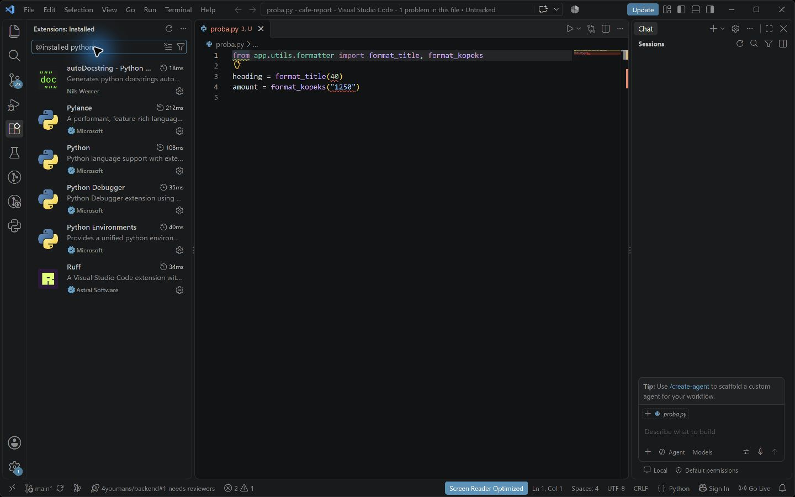
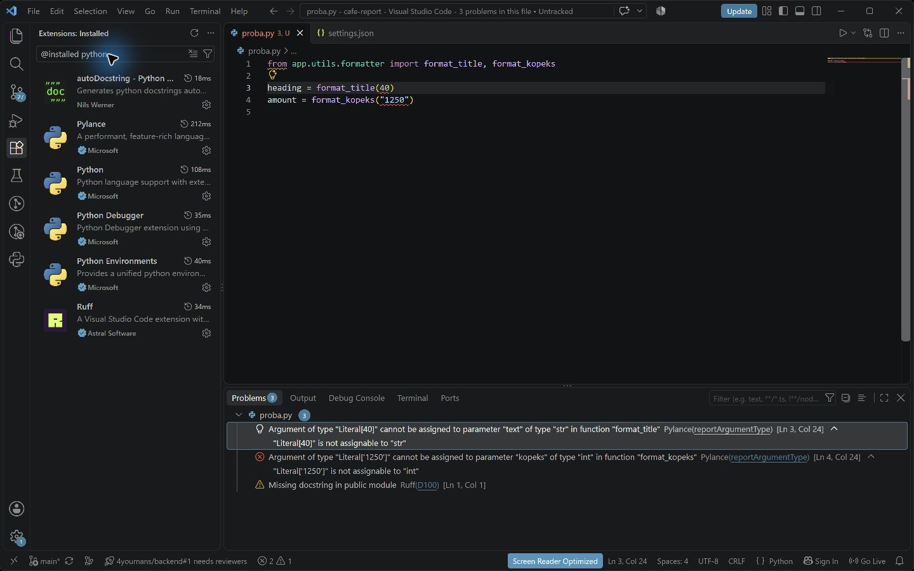
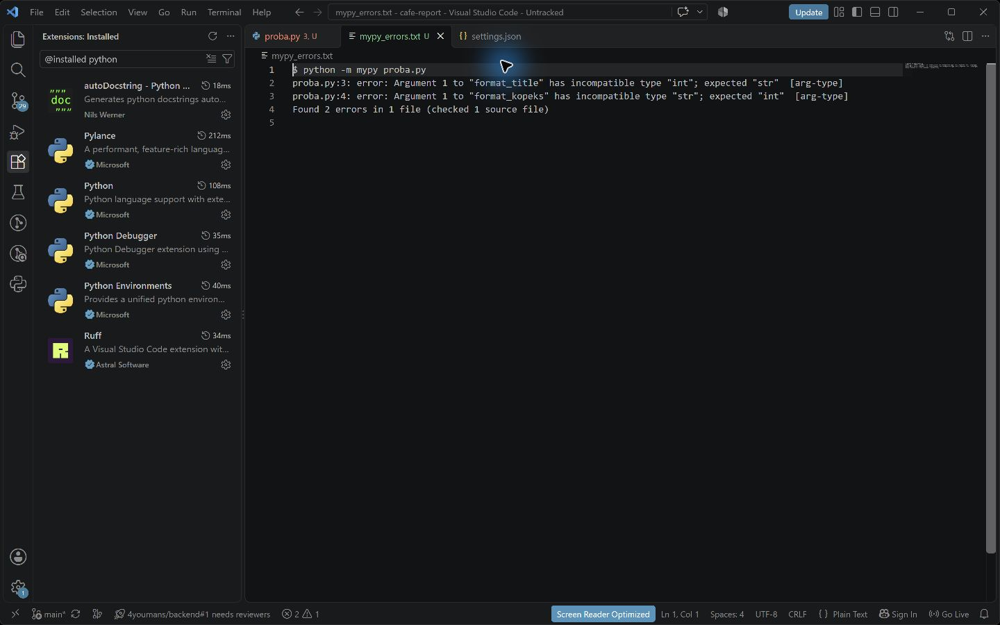

# Отчёт · Проверка типов: Pylance и mypy

**Студент:** Паюсов Семён

**Группа:** РПО 2\25

**Дата проверки:** 28.10.2026

Проект: [`cafe-report`](cafe-report/README.md). Язык: Python.
Проверки выполнены на Python 3.12.14, mypy 1.15.0, pytest 8.3.4.

## 1. Подготовка

Создана рабочая копия первого архива проекта без аннотаций.
В `cafe-report/.vscode/settings.json` записан режим `basic`.
Зависимости проекта перечислены в `requirements.txt`.
В `pyproject.toml` включено `disallow_untyped_defs = true`.
Это запрещает определения функций без аннотаций, даже если программа
успешно запускается.

## 2. Неверные вызовы

```python
from app.utils.formatter import format_title, format_kopeks

heading = format_title(40)
amount = format_kopeks("1250")
```

У `format_title` первый параметр `text: str`, поэтому целое число `40`
не подходит. У `format_kopeks` параметр `kopeks: int`, поэтому строка
`"1250"` не подходит. Исправления: `format_title("Отчёт")` и
`format_kopeks(1250)`.

| Часть сообщения mypy | Значение |
|---|---|
| `Argument 1` | Первый аргумент вызова |
| `incompatible type "int"; expected "str"` | Передан int, требуется str |
| `[arg-type]` | Код ошибки несовместимого типа аргумента |

Вывод с двумя базовыми ошибками и дополнительным вызовом варианта
приведён в [проверке задания 6](../lesson_06/checks/06_variant_1_errors.txt).
Файл для опытов в сдаваемый проект не включён.

## 3. Добавление аннотаций

Аннотации добавлены в порядке `utils`, `domain`, `services`, `ui`.
Проверка после каждого этапа запускалась командой `python -m mypy app`.

| Этап | Ошибки | Файлы с ошибками |
|---|---:|---:|
| Исходный проект | 17 | 10 |
| После utils | 12 | 7 |
| После domain | 8 | 5 |
| После services | 1 | 1 |
| После ui | 0 | 0 |

Пример изменения модуля `app/services/calculator.py`:

```python
# До
def grade_bounds(grades):
    if not grades:
        raise ValueError("Список оценок пуст")
    return min(grades), max(grades)

# После
def grade_bounds(grades: list[int]) -> tuple[int, int]:
    if not grades:
        raise ValueError("Список оценок пуст")
    return min(grades), max(grades)
```

Для `Shift.orders` добавлен тип `list[Order]`, для CSV-итератора —
`Iterator[dict[str, str]]`. Аннотации описывают существующие данные;
расчёты и форматирование вывода сохранены.

## 4. Итоговая проверка

`python -m mypy app`:

```text
Success: no issues found in 15 source files
```

`python -m pytest -q`:

```text
............                                                             [100%]
12 passed in 0.05s
```

`python main.py`:

```text
=========== Смена 28.10.2026 ===========
Петрова Анна                  2 480,50 ₽
Иванов Пётр                   1 685,00 ₽
Сидоров Илья                    772,00 ₽
=========== Итого 4 937,50 ₽ ===========
```

Полные результаты всех этапов: [checks](checks/05_initial.txt).

## 5. Выводы

Проверка типов находит несовместимые аргументы до выполнения программы.
Аннотации возвращаемых значений позволяют проверить код, который вызывает
функцию. mypy не подтверждает верность расчётной формулы: это проверяют
тесты и ожидаемый результат отчёта. Режим проверки редактора и конфигурация
mypy задаются отдельно, поэтому их сообщения могут различаться.

## 6. Проверка в VS Code и снимки

Установлены Python 2026.10.0 и Pylance 2026.4.1, также активен Ruff.
В `basic` Pylance показывает две ошибки `reportArgumentType`,
Ruff отдельно показывает `D100` у временного файла без докстринга.









Снимки сделаны в VS Code на текущем компьютере. Вывод команд на двух
последних снимках открыт как текстовый журнал в редакторе; это не панель
Terminal. Сами команды выполнены, их вывод сохранён без подмены.
Если проверка требует именно окно Terminal, эти два снимка нужно
дополнительно переснять вручную в терминале.
