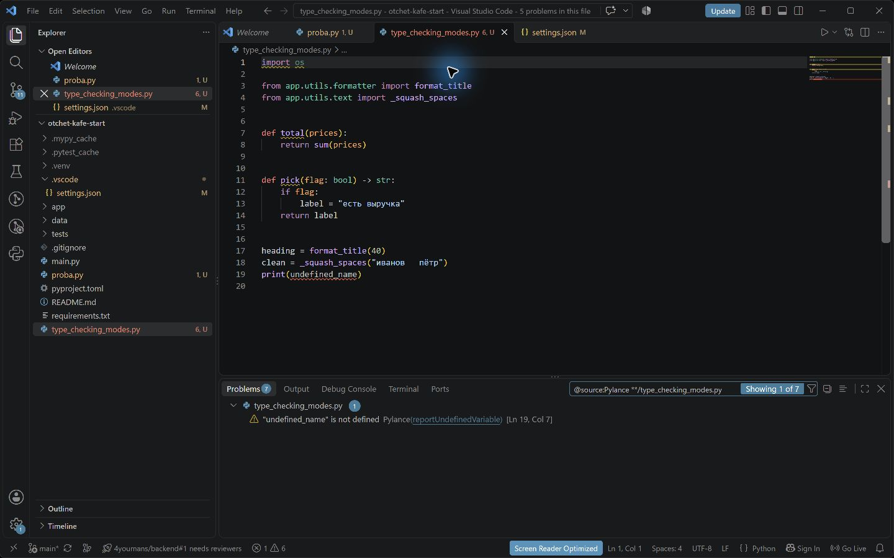
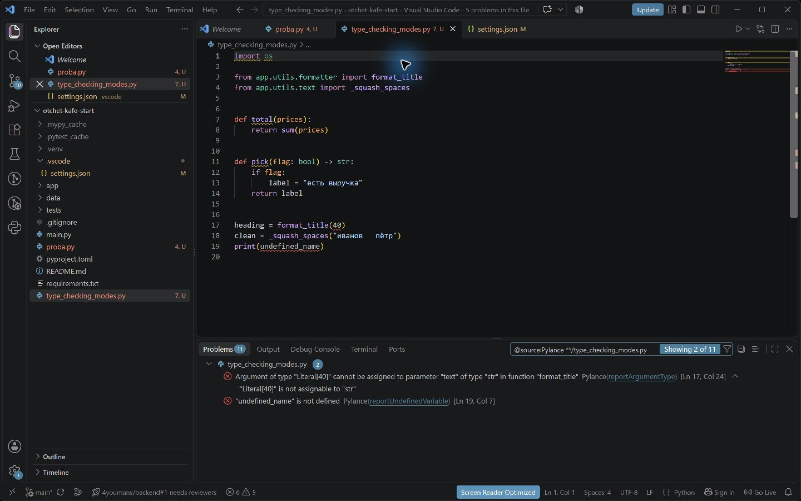
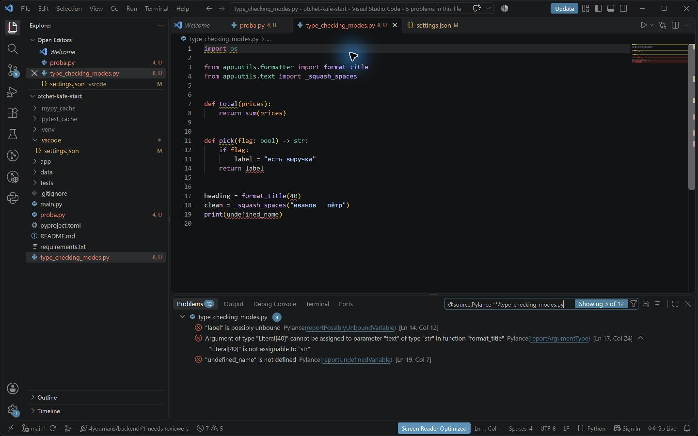
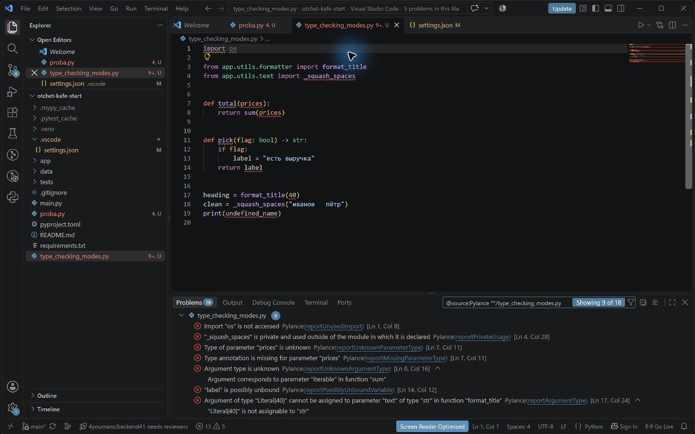
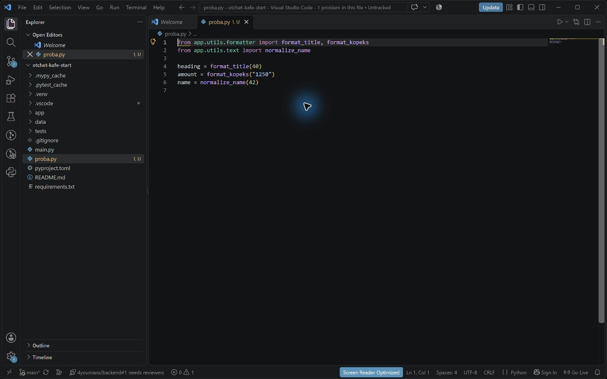
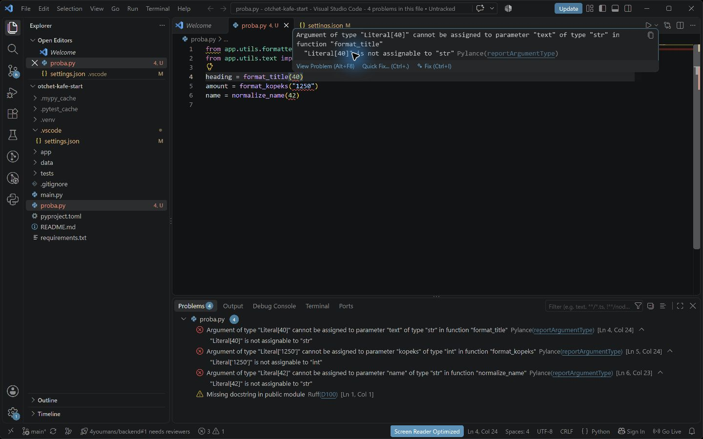
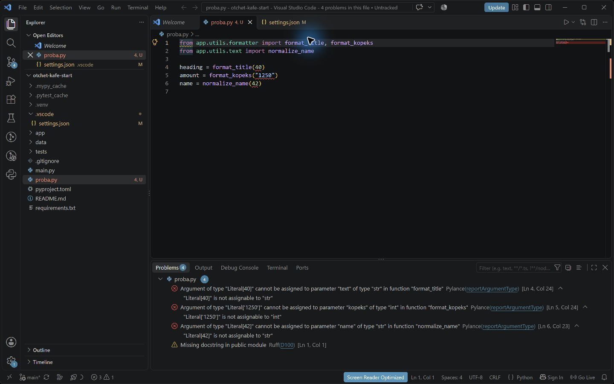
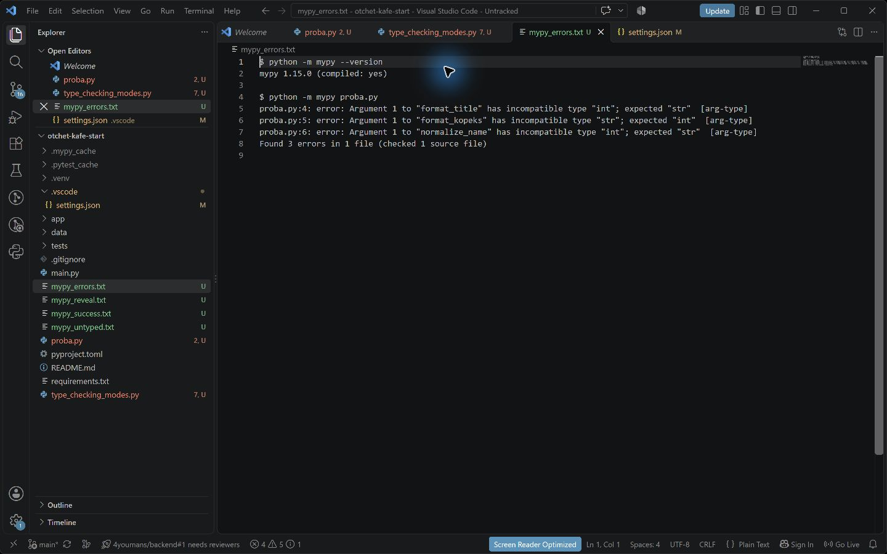
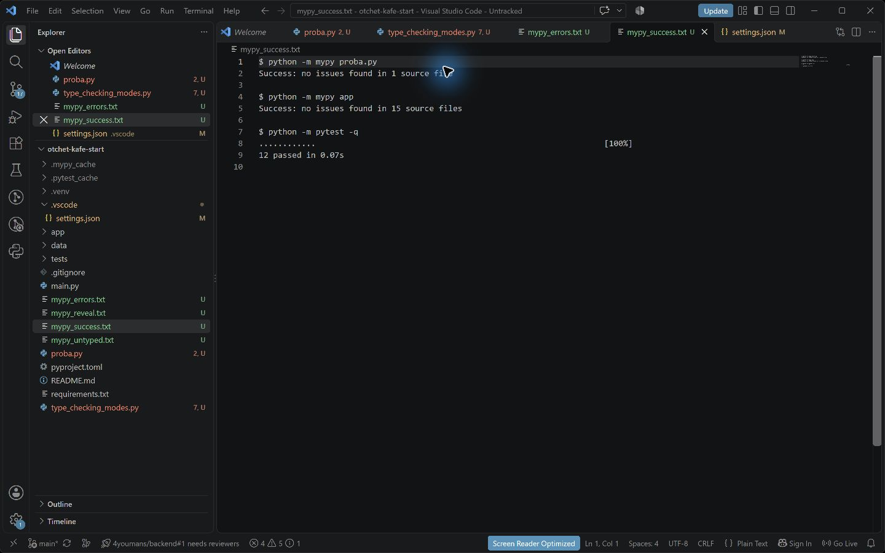
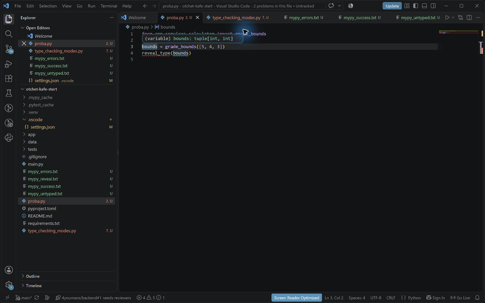

# Отчёт · Проверка типов: Pylance и mypy

**Студент:** Паюсов Семён

**Группа:** РПО 2\25

**Дата проверки:** 28.10.2026

**Номер в журнале:** пока неизвестен. Проверены все шесть вариантов шага 4.
Проект: [`otchet-kafe-start`](otchet-kafe-start/README.md).

## 1. Подготовка и режим basic

Использован второй архив проекта с аннотациями. В файл
`otchet-kafe-start/.vscode/settings.json` записан режим `basic`.
Временный файл `proba.py` использовался для опытов и удалён после проверки.

Базовые неверные вызовы:

```python
from app.utils.formatter import format_title, format_kopeks

heading = format_title(40)
amount = format_kopeks("1250")
```

Первый вызов передаёт `int` вместо `str` в параметр `text`.
Второй передаёт `str` вместо `int` в параметр `kopeks`.
В Pyright несовместимый аргумент имеет код `reportArgumentType`,
в mypy — `arg-type`.

## 2. Дополнительный вызов каждого варианта

В каждом опыте было два импорта, пустая строка, два базовых вызова
и один вызов варианта. Все три ошибочных вызова находились в строках 4–6.

| Вариант | Ошибочный вызов | Требуемый тип |
|---|---|---|
| 1 | `normalize_name(42)` | `str` |
| 2 | `calculate_average("5, 4, 3")` | `list[int]` |
| 3 | `revenue_by_waiter([], top="3")` | `int` |
| 4 | `save_report("report.txt", ["Итог"])` | `Path` |
| 5 | `print_report("Итог")` | `list[str]` |
| 6 | `format_title("Итог", "40")` | `int` |

Для каждого варианта mypy вывел три ошибки `arg-type`.
Пример вывода для варианта 4:

```text
proba.py:4: error: Argument 1 to "format_title" has incompatible type "int"; expected "str"  [arg-type]
proba.py:5: error: Argument 1 to "format_kopeks" has incompatible type "str"; expected "int"  [arg-type]
proba.py:6: error: Argument 1 to "save_report" has incompatible type "str"; expected "Path"  [arg-type]
Found 3 errors in 1 file (checked 1 source file)
```

mypy нумерует аргументы в сообщении (`Argument 1`); Pyright указывает имя
параметра. Для `save_report` первый параметр называется `path`.
В опыте варианта 1 Pylance показал ошибку `normalize_name(42)`
в строке 6, столбце 23. Две базовые ошибки: строки 4–5, столбец 24.
На снимке три ошибки Pylance и дополнительное предупреждение Ruff D100.

## 3. Четыре режима на одном файле

Проверен файл `type_checking_modes.py` из задания. Использован
**Pyright 1.1.408 CLI**; затем режимы проверены в VS Code
с Pylance 2026.4.1. В Problems применён фильтр
`@source:Pylance **/type_checking_modes.py`, чтобы исключить сообщения
Ruff и других открытых файлов.

| Режим | Ошибок Pyright CLI |
|---|---:|
| `off` | 0 |
| `basic` | 2 |
| `standard` | 3 |
| `strict` | 9 |

В редакторе Pylance: `off` — одно предупреждение `reportUndefinedVariable`,
`basic` — 2 ошибки, `standard` — 3, `strict` — 9. Поэтому нулевое число
ошибок CLI в `off` не означает, что панель редактора должна быть пустой.










В `standard` и `strict` выявлена потенциально неинициализированная
переменная `label`: `"label" is possibly unbound`, правило
`reportPossiblyUnboundVariable`. Если `flag` ложен, ветка присваивания
не выполнится. В `strict` дополнительно проверяются неизвестные типы,
неиспользуемые импорты и обращение к приватной функции.
В конфигурации проекта оставлен режим `basic`.

## 4. Исправленные вызовы

| Вариант | Исправление |
|---|---|
| 1 | `normalize_name("Иванов Пётр")` |
| 2 | `calculate_average([5, 4, 3])` |
| 3 | `revenue_by_waiter([Order("Иванов Пётр", 100)], top=3)` |
| 4 | `save_report(Path("report.txt"), ["Итог"])` |
| 5 | `print_report(["Итог"])` |
| 6 | `format_title("Итог", 40)` |

Для третьего варианта используется непустой список заказов: пустой список
при правильном типе аргумента вызывает `ValueError` во время исполнения.
Для четвёртого нужен `from pathlib import Path`, для третьего —
`from app.domain.order import Order`.

В каждом из шести исправленных опытов результат одинаков:

```text
Success: no issues found in 1 source file
```

Проверка пакета `app`:

```text
Success: no issues found in 15 source files
```

## 5. Проект без аннотаций

Первый архив проверен из корня второго проекта, чтобы применялся
параметр `disallow_untyped_defs = true` из его `pyproject.toml`.

```text
..\..\materials\tema-04-annotacii-tipov\otchet-kafe-bez-tipov\app\utils\text.py:1: error: Function is missing a type annotation  [no-untyped-def]
..\..\materials\tema-04-annotacii-tipov\otchet-kafe-bez-tipov\app\utils\text.py:5: error: Function is missing a type annotation  [no-untyped-def]
..\..\materials\tema-04-annotacii-tipov\otchet-kafe-bez-tipov\app\utils\formatter.py:1: error: Function is missing a type annotation  [no-untyped-def]
..\..\materials\tema-04-annotacii-tipov\otchet-kafe-bez-tipov\app\utils\formatter.py:5: error: Function is missing a type annotation  [no-untyped-def]
..\..\materials\tema-04-annotacii-tipov\otchet-kafe-bez-tipov\app\ui\console.py:1: error: Function is missing a type annotation  [no-untyped-def]
..\..\materials\tema-04-annotacii-tipov\otchet-kafe-bez-tipov\app\services\report_file.py:4: error: Function is missing a type annotation  [no-untyped-def]
..\..\materials\tema-04-annotacii-tipov\otchet-kafe-bez-tipov\app\services\calculator.py:1: error: Function is missing a type annotation  [no-untyped-def]
..\..\materials\tema-04-annotacii-tipov\otchet-kafe-bez-tipov\app\services\calculator.py:7: error: Function is missing a type annotation  [no-untyped-def]
..\..\materials\tema-04-annotacii-tipov\otchet-kafe-bez-tipov\app\services\importer.py:6: error: Function is missing a type annotation  [no-untyped-def]
..\..\materials\tema-04-annotacii-tipov\otchet-kafe-bez-tipov\app\domain\order.py:11: error: Function is missing a return type annotation  [no-untyped-def]
..\..\materials\tema-04-annotacii-tipov\otchet-kafe-bez-tipov\app\domain\order.py:11: note: Use "-> None" if function does not return a value
..\..\materials\tema-04-annotacii-tipov\otchet-kafe-bez-tipov\app\utils\clock.py:4: error: Function is missing a return type annotation  [no-untyped-def]
..\..\materials\tema-04-annotacii-tipov\otchet-kafe-bez-tipov\app\services\orders.py:7: error: Function is missing a type annotation  [no-untyped-def]
..\..\materials\tema-04-annotacii-tipov\otchet-kafe-bez-tipov\app\services\orders.py:14: error: Function is missing a type annotation  [no-untyped-def]
..\..\materials\tema-04-annotacii-tipov\otchet-kafe-bez-tipov\app\services\orders.py:26: error: Function is missing a type annotation  [no-untyped-def]
..\..\materials\tema-04-annotacii-tipov\otchet-kafe-bez-tipov\app\domain\shift.py:7: error: Function is missing a type annotation  [no-untyped-def]
..\..\materials\tema-04-annotacii-tipov\otchet-kafe-bez-tipov\app\domain\shift.py:11: error: Function is missing a type annotation  [no-untyped-def]
..\..\materials\tema-04-annotacii-tipov\otchet-kafe-bez-tipov\app\domain\shift.py:14: error: Function is missing a return type annotation  [no-untyped-def]
Found 17 errors in 10 files (checked 15 source files)
```

Все 17 ошибок имеют код `no-untyped-def`: у определений функций
отсутствуют аннотации. Запускаемый код может работать, но не отвечает
установленному требованию проверки типов.

## 6. Выведенный тип

```python
from app.services.calculator import grade_bounds

bounds = grade_bounds([5, 4, 3])
reveal_type(bounds)
```

```text
proba.py:4: note: Revealed type is "tuple[builtins.int, builtins.int]"
Success: no issues found in 1 source file
```

Тип — пара целых чисел `tuple[int, int]`. Подсказка Pylance
показала `(variable) bounds: tuple[int, int]` — это совпадает с mypy.

## 7. Проверка работоспособности

```text
............                                                             [100%]
12 passed in 0.07s
```

```text
=========== Смена 28.10.2026 ===========
Петрова Анна                  2 480,50 ₽
Иванов Пётр                   1 685,00 ₽
Сидоров Илья                    772,00 ₽
=========== Итого 4 937,50 ₽ ===========
```

## 8. Итог и оставшиеся действия

Если mypy и редактор показывают разное, следует проверить версии,
выбранный интерпретатор, корень проекта и оба файла конфигурации.
В отчёте приведены фактические результаты выполненных команд и собственные
снимки VS Code. Изображения вывода mypy сняты с сохранённых журналов,
открытых в редакторе; это не панель Terminal. Если требуется именно
терминал, снимки 7–9 нужно дополнительно переснять вручную в Terminal.

ИИ: использовался для подготовки кода, запусков проверок и текста отчёта.

## 9. Снимки выполнения














