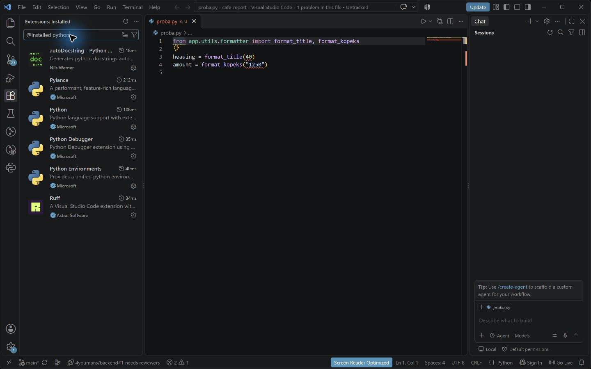
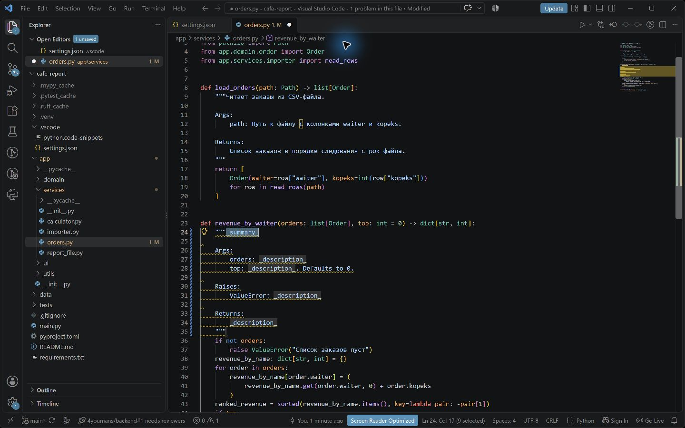
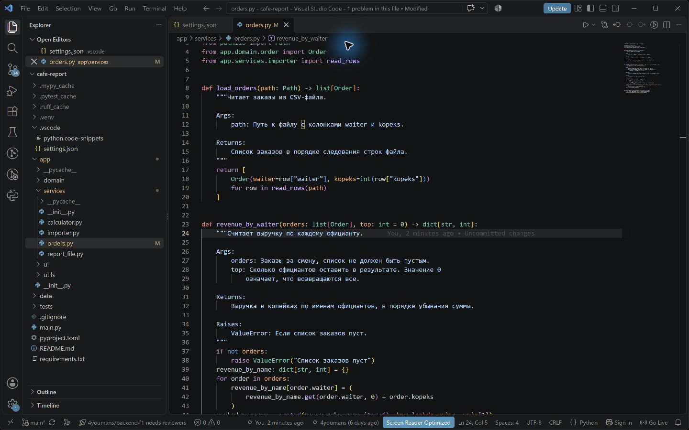
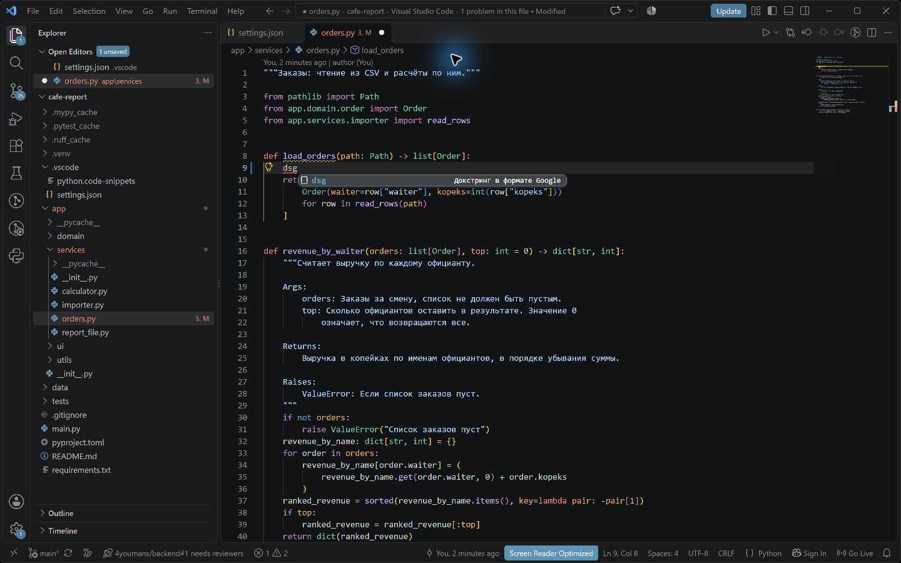
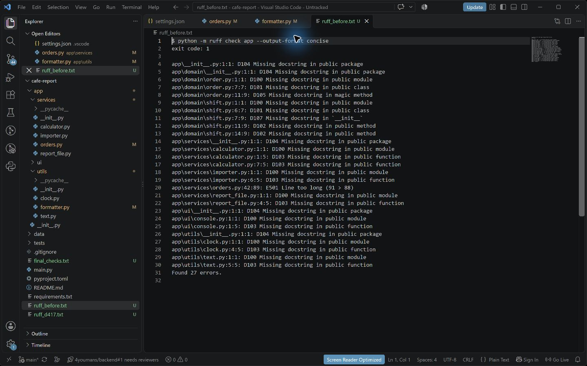
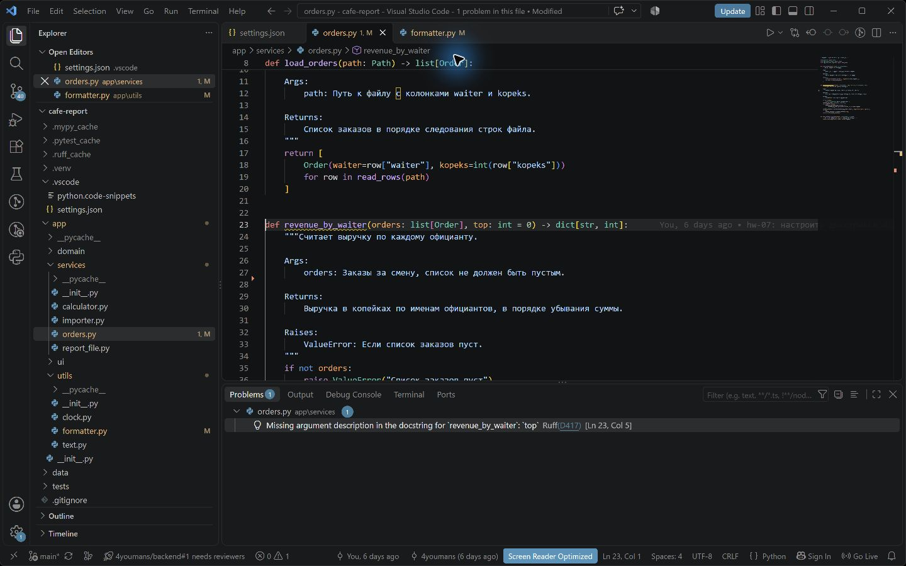
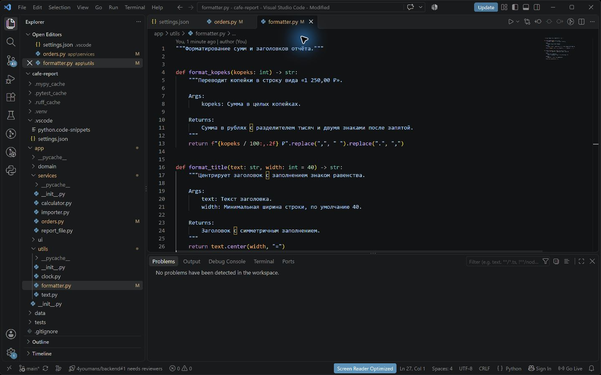
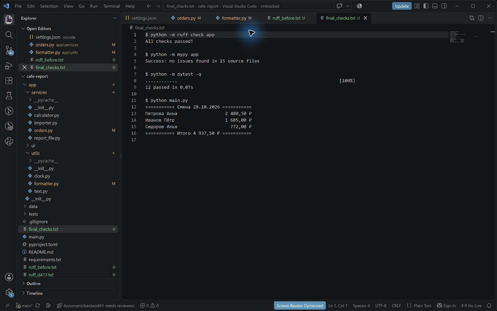

# Отчёт · Докстринги и проверка Ruff

**Студент:** Паюсов Семён

**Группа:** РПО 2\25

**Дата проверки:** 28.10.2026

**Номер в журнале:** пока неизвестен. Задокументированы все шесть модулей
из таблицы вариантов, а также остальные модули пакета `app`.
Проект: [`cafe-report`](cafe-report/README.md).

## 1. Настройки и сниппет

В проекте сохранены `.vscode/settings.json` с форматом `google-notypes`
и `.vscode/python.code-snippets` со сниппетом `dsg`.
Конфигурация Ruff использует `convention = "google"`.
Установлены autoDocstring 0.6.1 и Ruff 2026.92.0.
Генератор вызван командой `Generate Docstring` из палитры команд
у `revenue_by_waiter`. Ввод тройных кавычек и Enter в этом окружении
не вызвал расширение, поэтому использована его отдельная команда.
Сниппет `dsg` вызван в `load_orders` через Ctrl+Space и применён клавишей Tab.
После опытов возвращены заполненные описания параметров и результатов.

## 2. Докстринги

Описаны модули, классы и функции. Для параметров использован раздел
`Args:`, для результата — `Returns:`, для генератора CSV — `Yields:`,
для проверяемых условий исключений — `Raises:`.

Пример:

```python
def grade_bounds(grades: list[int]) -> tuple[int, int]:
    """Находит минимальную и максимальную оценки.

    Args:
        grades: Непустой список оценок.

    Returns:
        Пара из минимальной и максимальной оценок.

    Raises:
        ValueError: Если список оценок пуст.
    """
```

Проверены все модули вариантов: `utils/formatter.py`,
`services/calculator.py`, `services/report_file.py`, `utils/text.py`,
`services/importer.py`, `ui/console.py`.

## 3. Проверка Ruff

До правок текущая копия пакета содержала 27 замечаний Ruff.
После оформления всех докстрингов:

```text
All checks passed!
```

Пропущенная строка параметра `top` временно удалена из докстринга
`revenue_by_waiter`; Ruff получил:

```text
app\services\orders.py:23:5: D417 Missing argument description in the docstring for `revenue_by_waiter`: `top`
Found 1 error.
```

После опыта описание `top` восстановлено. Правило `D417` проверяет
соответствие раздела параметров подписи функции, но не смысл описания.

## 4. Проверка кода

```text
Success: no issues found in 15 source files
```

```text
............                                                             [100%]
12 passed in 0.11s
```

```text
=========== Смена 28.10.2026 ===========
Петрова Анна                  2 480,50 ₽
Иванов Пётр                   1 685,00 ₽
Сидоров Илья                    772,00 ₽
=========== Итого 4 937,50 ₽ ===========
```

Докстринги не изменяют расчёты. Итог отчёта — `4 937,50 ₽`.
Полные результаты находятся в `checks/`.

## 5. Снимки выполнения



















Вывод команд показан как сохранённый текст в VS Code. Снимки не являются
изображением панели Terminal. Для строгого соответствия требованию
снимка терминала этот этап нужно отдельно переснять вручную.

ИИ: использовался для подготовки докстрингов, проверки кода и текста отчёта.
